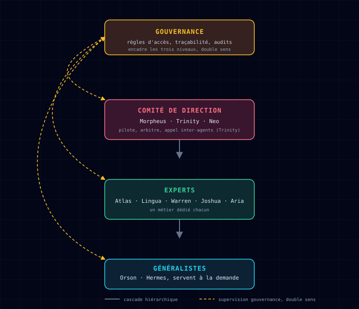

[also read: README.md (version française)](README.md)

# Secret Agent

A system of 10 specialized AI agents that I design and run every day since
February 2026. I am not a trained developer: I come from IT support, nine
years on the field.

**What you'll find here:** real incidents documented with their cause and
fix (`## What broke`), a full case study PDF telling that story
(`etude-de-cas.pdf`), real code that applies the governance rules described
below (`code/`), and a security checklist you can copy for your own agent
fleet (`gouvernance/regles-a-copier.md`). This repository shows the
architecture, the rules, and what broke along the way, not a demo.

## Today's numbers (recounted on November 14, 2026)

| Measure | Value |
|---|---|
| Active agents | 10 |
| Skills on the main profile (12 from a shared catalog, 109 custom) | 121 |
| Unique skills across the whole fleet | 203 |
| Active scheduled tasks (33 total, 2 paused) | 31 |
| Internal wiki entries | 81 |

## The 10 agents

[Morpheus](agents/morpheus.md) · [Trinity](agents/trinity.md) ·
[Neo](agents/neo.md) · [Atlas](agents/atlas.md) · [Lingua](agents/lingua.md) ·
[Warren](agents/warren.md) · [Joshua](agents/joshua.md) ·
[Aria](agents/aria.md) · [Orson](agents/orson.md) · [Hermes](agents/hermes.md)

## Org chart

Three levels, not two side-by-side circles: the leadership committee steers
and arbitrates, Experts each own a dedicated domain, Generalists (Orson,
Hermes) have no domain of their own and serve on demand. Governance
oversees all three levels both ways: no agent is above the audit, the
leadership committee included.

One agent only, Trinity, can ask another agent a precise question without
handing it a full task: Neo for simple execution, a Generalist on demand,
or Morpheus for reinforced judgment. The agent asked always answers with
its real expertise; if it is the wrong fit, it says so and recommends
another agent, and I validate the next one myself, never a self-redirecting
chain. Every call is logged.

Each agent has its own scope, its own memory, and does not see the other
agents' data by default. Access details: `gouvernance/matrice-acces.md`.

## A typical day

In the morning, an agent compiles the weather, the day's agenda, and pending
tasks into a single message, without me asking. During the day, one-off
requests (support, research, writing) go through conversation. In the
evening, a second agent summarizes what got done, what is still pending, and
prepares the next day. In between, scheduled tasks run on their own: news
monitoring, backups, system health checks. Real anonymized example:
`exemples/briefing-matin.md` and `exemples/journal-tache-planifiee.md`.

## Governance

Every agent has a written access scope, never assumed: which folders it can
read, which tools it can call, which secrets it is forbidden to touch even on
explicit request. Stop rules exist for risky actions (never a mass send,
never a deletion without confirmation, never reading certain credentials even
if asked again later). Every action leaves a readable trace. Details and a
real anonymized example: `gouvernance/matrice-acces.md` and
`gouvernance/audit-exemple-anonymise.md`. The concrete rules that came out
of it, copyable for your own fleet: `gouvernance/regles-a-copier.md`. Real
code that applies these principles: `code/`.

## What broke

Five real incidents, picked from 27 found since February 2026. The full
story, told, in PDF: `etude-de-cas.pdf` (French). Full technical detail
per incident, template Problem/Symptoms/Consequences/Fix/Rule:
`incidents/` (19 published, more coming in waves).

**May 3, 2026.** A file search was launched blocking in the main session
instead of being detached in the background. *Cause*: no rule distinguished
short tasks from long ones. *Fix*: any task over 30 seconds now runs in the
background, with an immediate acknowledgement. *Rule that came out of it*: an
agent must never go silent for more than a few seconds, even mid-task.

**May 3, 2026 (second incident that day).** A long-task protocol, entirely
invented by the agent (upfront announcement, automatic progress checkpoints,
process locking), was put in place without any instruction asking for it.
*Cause*: an initiative taken to anticipate an assumed need, never validated
by me. *Fix*: the protocol was entirely removed the same day. *Rule that came
out of it*: an agent does not invent its own protocol, it executes what is
asked and flags what it proposes before applying it.

**May 17, 2026.** Two chained messages arrived out of order, one of them
duplicated. *Cause*: a failed send was blindly retried as a whole batch
without checking which of the two had actually gone through. *Fix*: after any
chained send, check individually what landed before retrying anything.
*Rule that came out of it*: never blindly retry a whole batch because one
item in it failed.

**June 1, 2026.** An internal audit found that every scheduled task was
running with zero failure alerting configured. *Cause*: each task had been
built to work, but nobody had planned for the day it would silently fail.
*Fix*: an alert now fires on any failure. *Rule that came out of it*: a task
that succeeds today must also plan for the day it fails.

**November 14, 2026.** Installing a library for a simple test silently
changed the voice model choice for the entire fleet, with no configuration
saying so. The same incident revealed that a model documented for months had
in fact never run, for lack of a valid credential. *Cause*: the system
automatically prefers a local resource the moment it is detected, with no
warning. *Fix*: the model choice is now pinned explicitly; no more letting an
implicit default decide. *Rule that came out of it*: whatever is not
explicitly pinned will eventually drift on its own, silently.

## Limits and honesty

What I did not build myself: the agent runtime, the underlying language
models, the messaging infrastructure. These are existing, excellent tools
that I use.

What is genuinely mine: the two-circle architecture, the role split, the 121
custom skills that encode my own rules and lessons learned the hard way, the
governance guardrails, and the operating discipline that produced the five
incidents above, and their fixes.

What remains fragile: governance matured over time, not from day one. The
first months mostly produced attention errors (wrong channel, wrong format),
not infrastructure failures. A system like this still needs constant human
oversight: it does not self-correct, I write every rule after every failure.

## And in a company?

The same principle holds at any scale: specialized agents, a written scope
per agent, a trace of every action, and a stop rule before opening a new
access. The costliest failure is never an agent's reasoning, it is the
infrastructure nobody keeps watching because it worked yesterday: a shared
credential, a dependency installed without measuring its side effect, an
alert someone forgot to configure. Bringing AI into an existing system, with
its constraints, is exactly what this repository documents.

## Contact

[LinkedIn](https://www.linkedin.com/in/matthieulentin) · secretagentlab@agentmail.to
