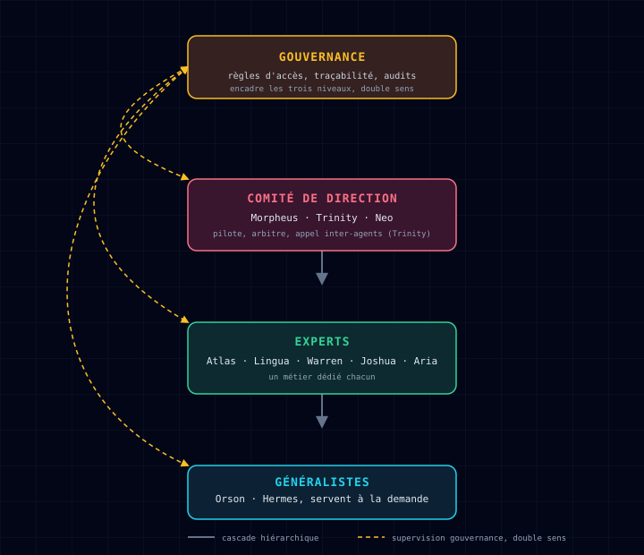

[lire aussi : README.en.md (English version)](README.en.md)

# Secret Agent

Un système de 10 agents IA spécialisés, que je conçois et j'exploite au
quotidien depuis février 2026. Je ne suis pas développeur de formation : je
viens du support informatique, neuf ans de terrain.

**Ce que vous trouverez ici :** des incidents réels documentés avec leur
cause et leur correctif (`## Ce qui a cassé`), une étude de cas complète en
PDF racontant ces échecs (`etude-de-cas.pdf`), du code réel qui applique les
règles de gouvernance décrites plus bas (`code/`), et une checklist de
sécurité à copier pour votre propre flotte d'agents
(`gouvernance/regles-a-copier.md`). Ce dépôt montre l'architecture, les
règles et ce qui a cassé en cours de route, pas une démonstration.

## Les chiffres du jour (recomptés le 14 novembre 2026)

| Mesure | Valeur |
|---|---|
| Agents actifs | 10 |
| Skills sur le profil principal (dont 12 d'un catalogue partagé, 109 sur mesure) | 121 |
| Skills uniques sur l'ensemble de la flotte | 203 |
| Tâches planifiées actives (33 au total, 2 en pause) | 31 |
| Fiches de connaissance (wiki interne) | 81 |

## Les 10 agents

[Morpheus](agents/morpheus.md) · [Trinity](agents/trinity.md) ·
[Neo](agents/neo.md) · [Atlas](agents/atlas.md) · [Lingua](agents/lingua.md) ·
[Warren](agents/warren.md) · [Joshua](agents/joshua.md) ·
[Aria](agents/aria.md) · [Orson](agents/orson.md) · [Hermes](agents/hermes.md)

## Organigramme

Trois niveaux, pas deux cercles côte à côte : le Comité de direction pilote
et arbitre, les Experts ont chacun un métier dédié, les Généralistes
(Orson, Hermes) n'ont pas de métier propre et servent à la demande. La
Gouvernance encadre les trois niveaux à double sens : aucun agent n'est
au-dessus de l'audit, le Comité de direction compris.

Un seul agent, Trinity, peut solliciter un autre agent pour une question
précise sans lui confier une tâche entière : Neo pour une exécution simple,
un Généraliste à la demande, ou Morpheus pour un jugement renforcé. L'agent sollicité répond toujours avec son expertise réelle ; s'il
estime ne pas être le bon interlocuteur, il le dit et recommande un autre
agent, et c'est moi qui valide le suivant, jamais une chaîne d'agents qui se
redirige seule. Chaque appel est tracé.

Chaque agent a son propre périmètre, sa propre mémoire, et ne voit pas les
données des autres par défaut. Détail des accès : `gouvernance/matrice-acces.md`.

## Une journée type

Le matin, un agent compile la météo, l'agenda du jour et les tâches en attente
dans un message unique, sans que j'aie à le demander. Pendant la journée, les
demandes ponctuelles (support, recherche, rédaction) passent par conversation.
Le soir, un second agent résume ce qui a été fait, ce qui reste en attente, et
prépare le lendemain. Entre les deux, des tâches planifiées tournent seules :
veille, sauvegardes, vérifications de santé du système. Exemple réel anonymisé :
`exemples/briefing-matin.md` et `exemples/journal-tache-planifiee.md`.

## Gouvernance

Chaque agent a un périmètre d'accès écrit, pas supposé : quels dossiers il lit,
quels outils il peut appeler, quels secrets lui sont interdits même sur demande
explicite. Des règles d'arrêt existent pour les actions à risque (jamais
d'envoi de masse, jamais de suppression sans confirmation, jamais de lecture
de certains identifiants même si je le redemande plus tard). Chaque action
laisse une trace relisible. Détail et exemple réel anonymisé :
`gouvernance/matrice-acces.md` et `gouvernance/audit-exemple-anonymise.md`.
Les règles concrètes qui en découlent, copiables pour votre propre flotte :
`gouvernance/regles-a-copier.md`. Du code réel qui applique ces principes :
`code/`.

## Ce qui a cassé

Cinq incidents réels, choisis parmi 27 retrouvés depuis février 2026.
L'histoire complète, racontée, en PDF : `etude-de-cas.pdf`. Le détail
technique complet, par incident, au gabarit Problème/Symptômes/
Conséquences/Solution/Règle : `incidents/` (7 publiés, d'autres à venir
par vagues).

**03 mai 2026.** Une recherche de fichiers a été lancée en blocage dans la
session principale au lieu d'être détachée en arrière-plan. *Cause* : aucune
règle ne distinguait les tâches courtes des tâches longues. *Correctif* : toute
tâche de plus de 30 secondes part désormais en tâche de fond, avec un retour
immédiat. *Règle qui en est sortie* : un agent ne doit jamais rester silencieux
plus de quelques secondes, même en plein travail.

**03 mai 2026 (second incident du jour).** Un protocole de gestion des tâches
longues, entièrement inventé par l'agent (annonce préalable, points d'étape
automatiques, verrouillage de processus), a été mis en place sans qu'aucune
instruction ne le demande. *Cause* : une initiative prise pour anticiper un
besoin supposé, jamais validée par moi. *Correctif* : le protocole a été
entièrement retiré le jour même. *Règle qui en est sortie* : un agent
n'invente pas son propre protocole, il exécute ce qui est demandé et signale
ce qu'il propose avant de l'appliquer.

**17 mai 2026.** Deux messages postés en chaîne sont arrivés dans le désordre
et l'un en double. *Cause* : un envoi en échec a été relancé en bloc sans
vérifier lequel des deux était réellement passé. *Correctif* : après tout envoi
en chaîne, vérifier individuellement ce qui est arrivé avant de relancer quoi
que ce soit. *Règle qui en est sortie* : ne jamais relancer à l'aveugle un
groupe d'actions à cause de l'échec d'une seule.

**01 juin 2026.** Un audit interne a découvert que toutes les tâches
planifiées tournaient sans la moindre alerte d'échec configurée. *Cause* :
chaque tâche avait été créée fonctionnelle, mais personne n'avait pensé au cas
de la panne silencieuse. *Correctif* : une alerte se déclenche désormais sur
tout échec. *Règle qui en est sortie* : une tâche qui réussit aujourd'hui doit
aussi prévoir le jour où elle échouera.

**14 novembre 2026.** L'installation d'une librairie pour un simple test a
changé, sans qu'aucune configuration ne le dise, le choix du modèle vocal de
toute la flotte. Le même incident a révélé qu'un modèle documenté depuis des
mois n'avait en réalité jamais tourné, faute d'identifiant valide. *Cause* :
le système préfère automatiquement une ressource locale dès qu'elle est
détectée, sans avertissement. *Correctif* : le choix du modèle est désormais
fixé explicitement, plus question de laisser un comportement implicite
décider. *Règle qui en est sortie* : ce qui n'est pas explicitement fixé finira
par changer tout seul, et en silence.

## Limites et honnêteté

Ce que je n'ai pas construit moi-même : le moteur d'exécution des agents, les
modèles de langage sous-jacents, l'infrastructure de messagerie. Ce sont des
outils existants, excellents, que j'utilise.

Ce qui est réellement de moi : l'architecture en deux cercles, la répartition
des rôles, les 121 skills sur mesure qui encodent mes propres règles et mes
propres pièges appris, les garde-fous de gouvernance, et la discipline
d'exploitation qui a produit les cinq incidents ci-dessus, et leurs
correctifs.

Ce qui reste fragile : la gouvernance a mûri avec le temps, pas dès le départ.
Les premiers mois ont surtout produit des erreurs d'attention (mauvais canal,
mauvais format), pas des pannes d'infrastructure. Un système de ce genre
suppose une supervision humaine constante : il ne s'auto-corrige pas, c'est
moi qui écris chaque règle après chaque échec.

## Et en entreprise ?

Le même principe tient à toute échelle : des agents spécialisés, un périmètre
écrit par agent, une trace de chaque action, et une règle d'arrêt avant
d'ouvrir un nouvel accès. L'erreur la plus coûteuse n'est jamais le
raisonnement d'un agent, c'est l'infrastructure qu'on cesse de regarder parce
qu'elle marchait hier : un identifiant partagé, une dépendance installée sans
mesurer son effet de bord, une alerte qu'on a oublié de configurer. Faire
entrer l'IA dans un système existant, avec ses contraintes, c'est exactement
ce que ce dépôt documente.

## Contact

[LinkedIn](https://www.linkedin.com/in/matthieulentin) · secretagentlab@agentmail.to
